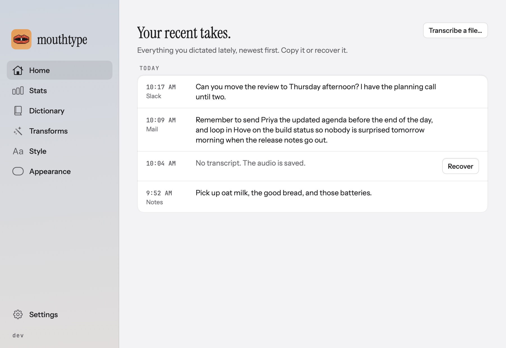
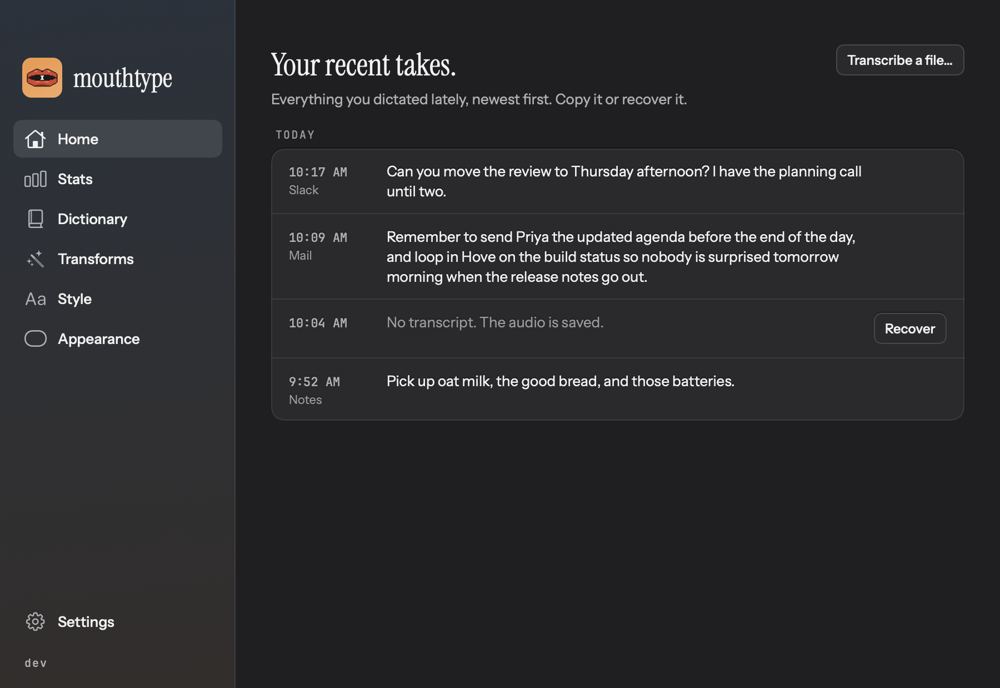
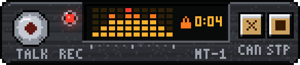

<h1 id="mouthtype">Mouthtype</h1>

**Local dictation for your Mac. Hold Fn, speak, release to paste.**

Natural speech in, clean text out.

  
  
  
  
  
  
  
  

> [!IMPORTANT]
> **Not verified on a device for 0.9.1:** fresh installation, VoiceOver, Bluetooth and USB microphones, press Return after inserting in a live app, and the Japanese, Hindi and Tamil Beta paths with their 1.6 GB model download. See [known limits](https://docs.mouthtype.app/reference/known-limits/).

<h2 align="center">Contents</h2>

- [Documentation](#documentation)
- [Quick Start](#quick-start)
- [Screenshots](#screenshots)
- [Why Mouthtype](#why-mouthtype)
- [Features](#features)
- [Privacy and Permissions](#privacy-and-permissions)
- [Feature Comparison](#feature-comparison)
- [Roadmap](#roadmap)
- [Build and Contribute](#build-and-contribute)
- [Experimental Linux Source](#experimental-linux-source)
- [Built With](#built-with)
- [Community and Support](#community-and-support)
- [CodesWhat Ecosystem](#codeswhat-ecosystem)
- [License](#license)

<h2 align="center" id="documentation">Documentation</h2>

| Resource | Link |
| --- | --- |
| Website | [mouthtype.app](https://mouthtype.app/) |
| Download | [mouthtype.app/download](https://mouthtype.app/download) |
| Getting started | [docs.mouthtype.app/getting-started](https://docs.mouthtype.app/getting-started/) |
| Docs | [docs.mouthtype.app](https://docs.mouthtype.app/) |
| Architecture | [docs/ARCHITECTURE.md](docs/ARCHITECTURE.md) |
| Dictating | [docs.mouthtype.app/dictating](https://docs.mouthtype.app/dictating/) |
| Install, update and remove | [docs.mouthtype.app/getting-started/install-notes](https://docs.mouthtype.app/getting-started/install-notes/) |
| Usage and cleanup reference | [docs.mouthtype.app/reference/usage-overview](https://docs.mouthtype.app/reference/usage-overview/) |
| Settings, tone rules and input selection | [docs.mouthtype.app/reference/settings](https://docs.mouthtype.app/reference/settings/) |
| Languages (25 European languages plus Japanese, Hindi and Tamil in Beta, what runs in each) | [docs.mouthtype.app/reference/languages](https://docs.mouthtype.app/reference/languages/) |
| Spoken commands and counted lists | [docs.mouthtype.app/reference/spoken-commands](https://docs.mouthtype.app/reference/spoken-commands/) |
| File transcription | [docs.mouthtype.app/transcribe-audio-files](https://docs.mouthtype.app/transcribe-audio-files/) |
| Saved audio and retention | [docs.mouthtype.app/privacy-and-data/saved-audio](https://docs.mouthtype.app/privacy-and-data/saved-audio/) |
| Automation (`mouthtype://` and the command-line script) | [docs.mouthtype.app/automation/url-scheme-and-cli](https://docs.mouthtype.app/automation/url-scheme-and-cli/) |
| Troubleshooting | [docs.mouthtype.app/troubleshooting](https://docs.mouthtype.app/troubleshooting/) |
| Known limits for 0.9.1 | [docs.mouthtype.app/reference/known-limits](https://docs.mouthtype.app/reference/known-limits/) |
| Release notes | [`packaging/ReleaseNotes.txt`](packaging/ReleaseNotes.txt) |
| Roadmap | See [Roadmap](#roadmap) below |
| Changelog | [`CHANGELOG.md`](CHANGELOG.md) |
| Contributing | [`CONTRIBUTING.md`](CONTRIBUTING.md) |
| Code of conduct | [`CODE_OF_CONDUCT.md`](CODE_OF_CONDUCT.md) |
| Governance | [`GOVERNANCE.md`](GOVERNANCE.md) |
| Security policy | [`SECURITY.md`](SECURITY.md) |
| Security controls and limits | [docs.mouthtype.app/reference/security](https://docs.mouthtype.app/reference/security/) |
| Third-party notices | [`THIRD_PARTY_NOTICES.md`](THIRD_PARTY_NOTICES.md) |
| Website development | [`website/README.md`](website/README.md) |
| Release procedure | [docs.mouthtype.app/maintainers/releasing](https://docs.mouthtype.app/maintainers/releasing/) |
| Corresponding release source | [mouthtype.app/source](https://mouthtype.app/source) |

<h2 align="center" id="quick-start">Quick Start</h2>

Mouthtype runs speech recognition and cleanup on your Mac. It puts the result in the text field you're already using, with local history and recovery when delivery fails. No account or transcription subscription is required.

The Mac app is at 0.9.1, a stable release. It supports **Apple Silicon and macOS 26 or later**. The signed app and corresponding release source are at [mouthtype.app/download](https://mouthtype.app/download) and [mouthtype.app/source](https://mouthtype.app/source).

1. Download the signed, notarized DMG from [mouthtype.app/download](https://mouthtype.app/download).
2. Open the DMG, drag Mouthtype to Applications and open it.
3. Grant Microphone and Accessibility access when prompted. The speech model and a small speech detector download on first launch.
4. Click an ordinary text field, hold **Fn**, speak, then release.

Prefer Homebrew? `brew install --cask codeswhat/tap/mouthtype` installs the same signed DMG build from the CodesWhat tap. The app still updates itself.

Hold Fn, double-tap Fn, or use Fn+Space. **Control+Command+V** pastes the last delivered take and **Control+Command+C** copies it. A single recording stops after 20 minutes, with a warning at 19.

See the [install notes](https://docs.mouthtype.app/getting-started/install-notes/) and the [getting-started guide](https://docs.mouthtype.app/getting-started/) for the full walkthrough. What changed in each release is in [`packaging/ReleaseNotes.txt`](packaging/ReleaseNotes.txt).

<h2 align="center" id="screenshots">Screenshots</h2>

<table>
<tr>
<td width="50%" align="center"><strong>Light</strong></td>
<td width="50%" align="center"><strong>Dark</strong></td>
</tr>
<tr>
<td align="center"></td>
<td align="center"></td>
</tr>
</table>

<table>
<tr>
<td width="50%" align="center"><strong>Classic pill</strong></td>
<td width="50%" align="center"><strong>Hi-Fi pill</strong></td>
</tr>
<tr>
<td align="center"></td>
<td align="center"></td>
</tr>
</table>

<h2 align="center" id="why-mouthtype">Why Mouthtype</h2>

You already know what you mean, and sometimes saying it is the easier way in. Mouthtype is a small tool for that: hold your shortcut, speak, release, and the text lands in the app you were using.

It runs on your machine. Recognition and cleanup are local once the models have downloaded, you don't need a Mouthtype account to dictate, and your recordings and history stay on your Mac. Cleanup aims to remove the rough edges while keeping your wording, and you pick how much of it you want. If delivery fails, the take is still saved, so you can copy or retry it.

It's early days. App compatibility, clipboard behavior and fresh-install setup still need wider testing. Read [why Mouthtype](https://mouthtype.app/why-mouthtype/) for the longer version.

<h2 align="center" id="features">Features</h2>

| | Feature | Description |
|---|---|---|
| 🎙️ | **Hold or Hands-Free Dictation** | Hold Fn, double-tap Fn, or use Fn+Space. Recording behavior and shortcuts are configurable. |
| 🧹 | **Local Cleanup** | Basic formatting works without a cleanup model. Fast (the default level) and Thorough use optional local models and preserve wording. Until the selected model finishes downloading, dictations use Basic. |
| 🎚️ | **Writing Rules** | Choose Formal, Casual, Very casual or Excited, with per-app and website rules for tone, cleanup level and your own instructions. |
| 📖 | **Saved Spellings and Phrases** | Keep exact local spelling rules and reusable text, including multiline phrases. Optional Boost my saved words favors them while recognizing. |
| ✍️ | **Transform Selection** | Preview Clean up, Fix grammar, Make shorter, More formal or More casual on text you've selected in another app, then explicitly accept the replacement. Accept only replaces the text if the app, field and selection are unchanged. |
| 📁 | **File Transcription** | Import one WAV, AIFF or M4A, up to 10 minutes and 512 MB, then explicitly copy or save the result. |
| 🎤 | **Microphone Selection** | Follow System Default, choose a named input, or opt into an ordered priority list. |
| 🛟 | **Recovery** | Copy or retry saved text after a failed paste. Interrupted audio remains recoverable, and Recover works on any take whose audio is still saved. |
| 🏠 | **Home and Stats** | Your last 50 takes on Home, and words, speed and streaks on Stats, all worked out on your Mac. Takes from secure fields are never counted. |
| 💊 | **Pill Styles** | A small recording pill in Classic, Hi-Fi, Glass, Matrix or Minimal, with Light and Dark previews and Standard or Large size. |
| 🖥️ | **Editor Hints** | Optional. With Boost my saved words on, Mouthtype can add up to 40 code names from VS Code, Cursor, Xcode and Terminal to the boost for one take. Nothing is kept after the take. |
| 🤖 | **Automation** | `mouthtype://` URLs and a `mouthtype` command-line script can start, stop, toggle, cancel, copy and paste the last take, and open a page. Dictation commands are off until you turn on the automation switch. |
| 🔄 | **Built-in Updates** | Signed update checks through Sparkle, with optional automatic checking. |

See [the usage reference](https://docs.mouthtype.app/reference/usage-overview/) for cleanup behavior, delivery limits and current caveats. **Quiet other audio** is on by default from 0.4.0 (it stays off if you turned it off before), and **Live words** is optional and off by default. Check the destination before retrying an interrupted paste, since some text may already have arrived. Split pastes preserve text. Splitting adds no Return between parts. If the app is on the Press Return after inserting list, one Return can follow the whole paste. Mouthtype confirms it first, except in terminals, where it presses Return a moment after the paste without checking.

<h2 align="center" id="privacy-and-permissions">Privacy and Permissions</h2>

Audio, transcripts, settings, spellings and phrases stay on this Mac. The default data directory is `~/Library/Application Support/Mouthtype/`. Text history is retained indefinitely. Completed audio defaults to 90 days and 2 GB; unfinished and recovery audio are protected from normal retention cleanup. The local database and recordings aren't encrypted by Mouthtype, so protect the Mac and its backups accordingly.

Microphone access records a take. Accessibility access handles the global shortcut, examines the destination and inserts text. Cleanup can read a small amount of nearby text for formatting and spelling hints, excluding secure fields. Phrase rules can explicitly insert the clipboard's text. These are powerful permissions; grant them only to a build you trust.

Model downloads and optional update checks use the network. Dictation and cleanup run locally. The [security policy](SECURITY.md) and [security controls and limits](https://docs.mouthtype.app/reference/security/) describe reporting, distribution integrity and the boundaries of those claims.

<h2 align="center" id="feature-comparison">Feature Comparison</h2>

<strong>How does Mouthtype compare to Apple Dictation and Wispr Flow?</strong>

> These are tradeoffs, not a scoreboard. We haven't run a controlled accuracy or speed benchmark against either product, and nothing here claims Mouthtype is more accurate or faster. &nbsp; ✅ = supported &nbsp; ❌ = not supported

<h4 align="center">Dictation tools</h4>

<table>
<thead>
<tr>
<th width="28%">What matters</th>
<th width="24%" align="center">Mouthtype</th>
<th width="24%" align="center">Apple Dictation</th>
<th width="24%" align="center">Wispr Flow</th>
</tr>
</thead>
<tbody>
<tr><td>Where it runs</td><td align="center">Apple Silicon Macs, macOS 26+. Experimental Linux source only.</td><td align="center">Part of macOS</td><td align="center">Mac, Windows, iOS and Android</td></tr>
<tr><td>Separate app to install</td><td align="center">✅</td><td align="center">❌</td><td align="center">✅1</td></tr>
<tr><td>Recognition</td><td align="center">Local, after model downloads</td><td align="center">On-device for general text on supported setups. Check your Mac's notice.</td><td align="center">Cloud, needs internet access</td></tr>
<tr><td>Cleanup</td><td align="center">Basic rules, or optional local Fast and Thorough models</td><td align="center">Automatic punctuation in supported languages, plus spoken punctuation and formatting commands</td><td align="center">Dictation and text cleanup together</td></tr>
</tbody>
</table>

> Stay with Apple Dictation if you want built-in dictation without another app and its output already suits you. Consider Wispr Flow if you want dictation across desktop and mobile and cloud processing works for your setup. Try Mouthtype if you want local recognition and cleanup on a supported Mac, explicit cleanup choices and a small app with optional skins.
>
> Product details checked October 16, 2026. See the [Apple Dictation](https://mouthtype.app/compare/apple-dictation/) and [Wispr Flow](https://mouthtype.app/compare/wispr-flow/) comparisons for sources. Contributions welcome if any information is inaccurate.
>
> 1 Wispr's help center tells you to download Flow and open it from the menu bar or system tray ([data sharing and local history](https://docs.wisprflow.ai/articles/9609615338-Private-Cloud-Sync-and-Data-Sharing-preferences-in-Wispr-Flow), URL checked 2026-10-21).

<h2 align="center" id="roadmap">Roadmap</h2>

<strong>Shipped and planned</strong>

High-level themes only, with no dates. [`CHANGELOG.md`](CHANGELOG.md) has per-release detail.

| Version | Theme | Highlights |
| --- | --- | --- |
| **0.1.x** ✅ | First stable release | Hold Fn, speak, release. Local recognition and cleanup, recovery after interrupted takes |
| **0.2.x** ✅ | Transform and boost | Transform selected text, optional Boost my saved words, cleanup level in app and website rules |
| **0.3.x** ✅ | Home and Stats | Home page with recent takes and Recover, Stats page, suggested spellings |
| **0.4.0** ✅ | One window | Single redesigned window, Transform Selection preview, Transforms page, separate Transcribe Audio File window, automation, editor hints |
| **0.5.0** ✅ | Speed and slash commands | Launch and dictation speed, spoken slash commands in coding apps, Show in Dock, a docs site, Fn remap and quit-path hardening, cleanup fixes, real app icons in Style lists |
| **0.6.0** ✅ | Languages and names | Dictation in 25 languages with Auto-detect, a mouse-button trigger, dictionary export and Wispr Flow and VoiceInk import, names on screen and a Models page in Setup, a silent-microphone warning, per-app cleanup instructions, an Excited tone, repeatable release builds, a Homebrew cask |
| **0.7.0** ✅ | Beta languages and fixes | Japanese, Hindi and Tamil dictation in Beta through a separate 1.6 GB Whisper model, selected-text cleanup tone precedence, dictionary and cleanup fixes, a website typing speed test with a countdown |
| **0.8.0** ✅ | Press Return after inserting | An opt-in list of apps where Mouthtype presses Return after a confirmed paste, and a Formal cleanup fix that keeps a real verb |
| **0.9.0** ✅ | Press Return in terminals | Press Return after inserting now works in terminals you add and in Electron apps like the Claude desktop app |
| **Planned** | Next | Linux desktop client acceptance and a supported release, a Ring pill style |

**Still open:** fresh-install, VoiceOver, and Bluetooth and USB microphone verification, and wider app-compatibility testing. See [known limits](https://docs.mouthtype.app/reference/known-limits/).

<h2 align="center" id="build-and-contribute">Build and Contribute</h2>

Install Xcode with Swift 6.2 on a supported Mac. Run `bash scripts/run-app.sh` to build and open a signed app bundle. Without a Developer ID identity, the script uses ad-hoc signing; permission grants and distribution guarantees differ from the released app.

Run `swift test` for core, macOS integration logic, Settings rendering and Fn guardian tests. Desktop self-tests take focus and require a free desktop. Tests don't replace physical microphone or third-party app acceptance.

Read [CONTRIBUTING.md](CONTRIBUTING.md) for checks, dependency maintenance and the reviewed development-branch workflow. Report vulnerabilities through [SECURITY.md](SECURITY.md).

<h2 align="center" id="experimental-linux-source">Experimental Linux Source</h2>

Linux work targets x86_64 Arch/Omarchy, Hyprland and PipeWire. The source includes a daemon/CLI, setup diagnostics, an Omarchy bar plugin with a floating pill, single-file audio transcription, optional paste or typing delivery and optional local Fast and Thorough cleanup models. Delivery is recovery-only and cleanup is off by default. **There is no supported Linux desktop release.** Physical acceptance remains open, and the Linux cleanup models differ from the Mac ones (Thorough is Qwen3 4B, not Gemma). Follow the [Linux setup and testing guide](https://docs.mouthtype.app/linux/linux-desktop-setup/) or the [Omarchy plugin guide](https://docs.mouthtype.app/linux/linux-omarchy-plugin/).

<h2 align="center" id="built-with">Built With</h2>

Licenses for each component are in [THIRD_PARTY_NOTICES.md](THIRD_PARTY_NOTICES.md).

<strong>Components and licenses</strong>

| Component | What it does | License |
| --- | --- | --- |
| [FluidAudio](https://github.com/FluidInference/FluidAudio) | Runs the Parakeet speech models on Core ML | Apache-2.0 |
| [WhisperKit](https://github.com/argmaxinc/WhisperKit) | Alternative Whisper speech recognition | MIT |
| [mlx-swift-lm](https://github.com/ml-explore/mlx-swift-lm) | Runs the local cleanup models on MLX | MIT |
| [Sparkle](https://github.com/sparkle-project/Sparkle) | Signed update checks | MIT |
| [GRDB.swift](https://github.com/groue/GRDB.swift) | SQLite storage for local history | MIT |
| [Parakeet TDT 0.6B v3](https://huggingface.co/nvidia/parakeet-tdt-0.6b-v3) | Speech recognition | CC BY 4.0 |
| [Silero VAD](https://huggingface.co/FluidInference/silero-vad-coreml) | Speech detection | MIT |
| [S1-mini](https://huggingface.co/superwhisper/s1-mini) | Fast cleanup | Apache-2.0 plus a naming clause |
| [Gemma 4 E4B](https://huggingface.co/mlx-community/gemma-4-e4b-it-4bit) | Thorough cleanup | Apache-2.0 |

Speech recognition uses NVIDIA's Parakeet models, converted to Core ML by FluidInference. No model is bundled; each downloads on request.

<h2 align="center" id="community-and-support">Community and Support</h2>

Open an [issue](https://github.com/CodesWhat/mouthtype/issues) for bugs, or ask in [Discussions](https://github.com/CodesWhat/mouthtype/discussions). Include the app version, macOS version, destination app and reproduction steps; omit personal transcripts and recordings. Report vulnerabilities through [SECURITY.md](SECURITY.md), not in an issue. The [troubleshooting guide](https://docs.mouthtype.app/troubleshooting/) covers the problems you can hit today.

<h2 align="center" id="codeswhat-ecosystem">CodesWhat Ecosystem</h2>

<table>
  <tr><th>Tool</th><th>Role</th></tr>
  <tr><td><b>mouthtype</b></td><td>Local dictation for Mac. Hold Fn, speak, release to paste</td></tr>
  <tr><td><a href="https://github.com/CodesWhat/drydock"><b>drydock</b></a></td><td>Container update monitoring, web UI and notification engine</td></tr>
  <tr><td><a href="https://github.com/CodesWhat/portwing"><b>portwing</b></a></td><td>Remote Docker agent, secure socket-level access from Drydock or standalone</td></tr>
  <tr><td><a href="https://github.com/CodesWhat/sockguard"><b>sockguard</b></a></td><td>Docker socket proxy, default-deny allowlist filter protecting the socket</td></tr>
</table>

Mouthtype is the one desktop app here. The other three tools are for Docker hosts and are designed to layer: sockguard filters the socket, portwing exposes it remotely, and drydock monitors and acts on container state.

<h2 align="center" id="license">License</h2>

Mouthtype is licensed under [GPL-3.0](LICENSE). [Corresponding release source](https://mouthtype.app/source) is available separately from the app download. Dependencies, fonts, adapted code and downloaded models have their own terms. [THIRD_PARTY_NOTICES.md](THIRD_PARTY_NOTICES.md) records adapted code, fonts, the S1-mini model, the Swift package dependencies and the downloaded models.

<a href="https://codeswhat.com">
  <picture>
    <source media="(prefers-color-scheme: dark)" srcset="docs/assets/codeswhat-logo-dark.svg" />
    <source media="(prefers-color-scheme: light)" srcset="docs/assets/codeswhat-logo-original.svg" />
    
  </picture>
</a>

[CodesWhat](https://codeswhat.com): small, sharp tools from one developer and a lot of agents.

<a href="#mouthtype">Back to top</a>

